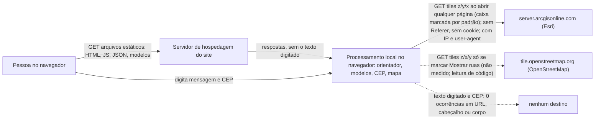

# Auditoria de privacidade: o que sai do aparelho

> Auditoria feita sobre o código em `web/`, servido por um servidor estático local, com mensagens e CEP fictícios. Ela mostra o que **este navegador, neste ambiente** enviou; não é uma prova sobre outros navegadores, extensões ou o servidor de hospedagem.

## Como foi gerado

- Comando: `python reproducao\auditoria_privacidade_cep.py`
- Commit: `0755520d6ca18e0744801f585fec415396af965e` (ramo `auditoria/cep-medicao`); alterações fora de `reproducao/`: nenhuma
- Navegador: Chromium 156.0.8078.4 (Playwright); Node `v24.14.0`; Python `3.14.3`; sistema `Windows-11-10.0.26200-SP0`; data (UTC) 2026-11-06 14:37:18
- Mensagem fictícia: «Preciso de ajuda fictícia para a vaga de creche da pequena Zorzalina Quimérica». CEP fictício: `13500-230`.
- Cada cenário roda em um contexto de navegador novo (sem cache, cookies nem armazenamento anteriores). O registro completo, com cabeçalhos e corpo de cada requisição, está em `reproducao/resultados/auditoria_requisicoes.json`.
- Para repetir: `python -m pip install playwright`, `python -m playwright install chromium` e `python reproducao/auditoria_privacidade.py`.

## Cenário 1: Página inicial, sem interação

- Requisições totais: 31 (locais: 31, para outros domínios: 0); com método diferente de GET ou com corpo: 0.
- Texto digitado ou CEP encontrados em alguma URL, cabeçalho ou corpo: não.
- Locais por tipo: document 1, fetch 10, image 2, script 16, stylesheet 2; 1581 KiB baixados do próprio servidor.

Armazenamento ao fim do cenário:

- localStorage: `{}`
- sessionStorage: `{}`
- IndexedDB: `[]`
- cookies: `document.cookie` = «»; no contexto: `[]`

## Cenário 2: Mensagem fictícia no orientador

Observações do cenário: resposta_exibida_em_ia_saida = True; caracteres_da_resposta = 1555; marcos (s desde o início): antes_de_digitar = 0.8.

- Requisições totais: 35 (locais: 35, para outros domínios: 0); com método diferente de GET ou com corpo: 0.
- Texto digitado ou CEP encontrados em alguma URL, cabeçalho ou corpo: não.
- Locais por tipo: document 1, fetch 14, image 2, script 16, stylesheet 2; 3760 KiB baixados do próprio servidor.

Armazenamento ao fim do cenário:

- localStorage: `{}`
- sessionStorage: `{}`
- IndexedDB: `[]`
- cookies: `document.cookie` = «»; no contexto: `[]`

## Cenário 3: CEP de teste no mapa de serviços da página inicial

Observações do cenário: mensagem_do_site = Região aproximada pelo CEP 13500-230 (raio de cerca de 1500 m). Não é o seu endereço. Este CEP cobre uma área grande: a ordem por distância é só uma ideia.; marcos (s desde o início): antes_de_digitar = 0.8.

- Requisições totais: 31 (locais: 31, para outros domínios: 0); com método diferente de GET ou com corpo: 0.
- Texto digitado ou CEP encontrados em alguma URL, cabeçalho ou corpo: não.
- Locais por tipo: document 1, fetch 10, image 2, script 16, stylesheet 2; 1581 KiB baixados do próprio servidor.

Armazenamento ao fim do cenário:

- localStorage: `{}`
- sessionStorage: `{}`
- IndexedDB: `[]`
- cookies: `document.cookie` = «»; no contexto: `[]`

## Cenário 4: Mapa de serviços com a caixa de imagens do mapa marcada (padrão)

Observações do cenário: caixa_marcada_por_padrao = False.

- Requisições totais: 31 (locais: 31, para outros domínios: 0); com método diferente de GET ou com corpo: 0.
- Texto digitado ou CEP encontrados em alguma URL, cabeçalho ou corpo: não.
- Locais por tipo: document 1, fetch 10, image 2, script 16, stylesheet 2; 1581 KiB baixados do próprio servidor.

Armazenamento ao fim do cenário:

- localStorage: `{}`
- sessionStorage: `{}`
- IndexedDB: `[]`
- cookies: `document.cookie` = «»; no contexto: `[]`

## Cenário 5: Mapa de serviços com a caixa desmarcada antes de o mapa iniciar (simulado por script de inicialização)

Observações do cenário: caixa_marcada_no_fim = False; simulacao = desmarcada por script de inicialização, antes do mapa iniciar.

- Requisições totais: 31 (locais: 31, para outros domínios: 0); com método diferente de GET ou com corpo: 0.
- Texto digitado ou CEP encontrados em alguma URL, cabeçalho ou corpo: não.
- Locais por tipo: document 1, fetch 10, image 2, script 16, stylesheet 2; 1581 KiB baixados do próprio servidor.

Armazenamento ao fim do cenário:

- localStorage: `{}`
- sessionStorage: `{}`
- IndexedDB: `[]`
- cookies: `document.cookie` = «»; no contexto: `[]`

## Cenário 5b: Mapa de serviços: caixa desmarcada depois de carregar, com zoom

Observações do cenário: controle_de_zoom_encontrado = True; marcos (s desde o início): antes_de_desmarcar = 2.9, depois_de_desmarcar = 3.0.

- Requisições totais: 31 (locais: 31, para outros domínios: 0); com método diferente de GET ou com corpo: 0.
- Texto digitado ou CEP encontrados em alguma URL, cabeçalho ou corpo: não.
- Locais por tipo: document 1, fetch 10, image 2, script 16, stylesheet 2; 1581 KiB baixados do próprio servidor.

Armazenamento ao fim do cenário:

- localStorage: `{}`
- sessionStorage: `{}`
- IndexedDB: `[]`
- cookies: `document.cookie` = «»; no contexto: `[]`

## Cenário 6: Mapa 'perto de mim' (OpenStreetMap) com a opção de ruas ligada, após CEP fictício

Observações do cenário: busca_por_cep_visivel = True; resultado_com_mapa_visivel = True; mensagem_do_site = (sem mensagem); caixa_ruas_marcada_por_padrao = False; marcos (s desde o início): antes_de_marcar_ruas = 3.4, depois_de_marcar_ruas = 3.5.

- Requisições totais: 46 (locais: 31, para outros domínios: 15); com método diferente de GET ou com corpo: 0.
- Texto digitado ou CEP encontrados em alguma URL, cabeçalho ou corpo: não.
- Locais por tipo: document 1, fetch 10, image 2, script 16, stylesheet 2; 1185 KiB baixados do próprio servidor.

Requisições para outros domínios:

| # | t (s) | Método | Domínio | Caminho | Tamanho (B) | Status | Referer enviado | Cookie enviado |
|---|---|---|---|---|---|---|---|---|
| 1 | 3.5 | GET | tile.openstreetmap.org | `/12/1506/2309.png` | 29577 | 200 | não enviado | não |
| 2 | 3.5 | GET | tile.openstreetmap.org | `/12/1506/2308.png` | 12466 | 200 | não enviado | não |
| 3 | 3.5 | GET | tile.openstreetmap.org | `/12/1505/2309.png` | 15045 | 200 | não enviado | não |
| 4 | 3.5 | GET | tile.openstreetmap.org | `/12/1507/2309.png` | 17694 | 200 | não enviado | não |
| 5 | 3.5 | GET | tile.openstreetmap.org | `/12/1506/2310.png` | 16237 | 200 | não enviado | não |
| … | | | | 10 requisições a mais, de mesmo tipo (lista completa em `reproducao/resultados/auditoria_requisicoes.json`) | | | | |

Resumo por resultado: 200 = 15; 227 KiB recebidos nas concluídas.

- **OpenStreetMap:** 15 tiles, zoom 12 a 12. No zoom 12: canto noroeste ≈ (-22.2688, -47.8125), canto sudeste ≈ (-22.5126, -47.3730) (latitude, longitude). Os tiles pedidos delimitam a região do mapa que a usuária está vendo.

Armazenamento ao fim do cenário:

- localStorage: `{}`
- sessionStorage: `{}`
- IndexedDB: `[]`
- cookies: `document.cookie` = «»; no contexto: `[]`

## Síntese

| Cenário | Requisições locais | Para outros domínios | Tiles de mapa | Método ≠ GET ou com corpo | Texto/CEP encontrados |
|---|---|---|---|---|---|
| 1 | 31 | 0 | 0 | 0 | 0 |
| 2 | 35 | 0 | 0 | 0 | 0 |
| 3 | 31 | 0 | 0 | 0 | 0 |
| 4 | 31 | 0 | 0 | 0 | 0 |
| 5 | 31 | 0 | 0 | 0 | 0 |
| 5b | 31 | 0 | 0 | 0 | 0 |
| 6 | 31 | 15 | 15 | 0 | 0 |

Total de ocorrências do texto digitado ou do CEP em URL, cabeçalho ou corpo, em todos os cenários: **0**. Requisições com método diferente de GET ou com corpo: **0**.

## Achados

1. **Busca por exposição do texto e do CEP:** Em 236 requisições registradas nos cenários, foram encontradas 0 requisições com ocorrência detectada em URL, cabeçalho ou corpo, entre 236 requisições registradas.
2. **A caixa de imagens do mapa de serviços vem marcada por padrão: não** (achado, não alterado nesta tarefa). Por isso, **só abrir a página inicial** (cenário 1), sem interação, já gera 0 requisições de tiles para `server.arcgisonline.com` (Esri): 0 concluídas e 0 canceladas pelo próprio mapa (`net::ERR_ABORTED`, tiles de zoom intermediário). O mesmo ocorre ao abrir a área Educação (cenário 6), porque o mapa da página inicial é iniciado em qualquer rota.
3. **Desmarcar a caixa antes de o mapa iniciar elimina as requisições** (cenário 5: 0 requisições externas), mas isso foi feito por um script de inicialização: uma pessoa só vê a caixa depois do primeiro desenho do mapa, quando os tiles já foram pedidos. **Desmarcar depois de carregar interrompe as requisições seguintes** (cenário 5b: última requisição externa em 0.0 s, antes de desmarcar em 3.0 s, e nenhuma depois, mesmo com zoom).
4. **Referer:** nenhuma das requisições externas concluídas enviou o cabeçalho Referer, o que é coerente com a meta `referrer` igual a `no-referrer` em `web/index.html`. Essa observação descreve apenas os cabeçalhos efetivamente capturados nesta execução. Cookies: nenhuma requisição externa concluída enviou cookie.
5. **Armazenamento:** em todos os cenários, localStorage, sessionStorage, IndexedDB e cookies terminaram vazios.
6. **O que não foi medido:** (a) o mapa "perto de mim" com a opção de ruas do OpenStreetMap (cenário 6) não pôde ser exercitado, porque o CEP fictício não existe no índice de Rio Claro (o site responde "Não encontramos este CEP" e não mostra o mapa); a consulta ao OpenStreetMap, que só ocorre se a pessoa marcar a caixa, foi verificada apenas **por leitura do código** (`web/app.js`, ouvinte de `usar-tiles`), não por medição. (b) Com um CEP **válido**, a leitura de `web/mapa.js` (função `aplicarCep` e o ajuste de vista com `fitBounds`, no máximo zoom 15) indica que o mapa passa a enquadrar a região do CEP e que os tiles pedidos à Esri passariam a delimitar essa região em escala de alguns quilômetros; isso **não foi medido**, pois exigiria um CEP real.

## O que exatamente sai do aparelho

- **Para `tile.openstreetmap.org`:** pedidos `GET` de imagens de mapa (tiles) com os números de zoom, coluna e linha do tile na URL. No cenário 4 foram 0 pedidos (0 concluídos, 0 KiB; 0 cancelados), nos zooms 11 e 12, delimitando a região de Rio Claro (cerca de latitude −22,27 a −22,51 e longitude −47,81 a −47,29 no zoom 12). Esses números mostram **que região do mapa a pessoa está vendo**, não onde ela está.
- **Cabeçalhos enviados nesses pedidos** (amostra concluída, cenário 4): `accept`, `accept-encoding`, `accept-language` (aqui `pt-BR`), `user-agent`, `sec-ch-ua*`, `sec-fetch-*` (`cross-site`), `host` e `connection`. Sem `referer`, sem `cookie`, sem `origin`. Além disso, o servidor que recebe o pedido vê o **endereço IP** do aparelho, o que é inerente a qualquer requisição de rede.
- **Para o servidor de hospedagem do site:** só os pedidos dos arquivos estáticos (HTML, CSS, JS, JSON de dados e modelos). Nenhum pedido levou o texto digitado ou o CEP. O servidor de hospedagem de produção pode manter registros de acesso próprios; isto não foi auditado.

## Diagrama do fluxo de dados

## A frase mais forte que as evidências sustentam

> Nos cenários testados, com mensagem fictícia e CEP 13500-230, em Chromium 156.0.8078.4 e com o site servido localmente, o detector encontrou 0 requisições com ocorrência do texto ou CEP em URL, cabeçalho ou corpo, entre 236 requisições. Houve algum dado persistido ao fim de um cenário: False. As comunicações externas, domínios e tiles observados estão discriminados nas tabelas acima.

**O que a frase não afirma:** que "nada sai do aparelho" (saem pedidos de tiles e o IP); que isso vale para outros navegadores, extensões ou redes; o comportamento com outros CEPs; o comportamento do servidor de hospedagem de produção; nem o uso do OpenStreetMap (verificado só por leitura de código).

## Limites desta auditoria

- Ambiente: um Chromium em modo sem interface, servidor local em `127.0.0.1`, uma única passagem por cenário (sem repetições). Em produção, o domínio e o HTTPS são outros.
- A busca por vazamento procura as formas exatas e trechos de três palavras do texto fictício, e as formas do CEP; transformações (por exemplo, hash ou codificação própria) não seriam detectadas.
- Os cabeçalhos de pedidos cancelados não têm versão final capturada; o `Referer` e o `Cookie` foram conferidos nos pedidos concluídos, que são a mesma chamada de tiles.
- O README diz que as únicas requisições são arquivos locais e tiles do OpenStreetMap só com opt-in; esta auditoria mostra tiles da Esri por padrão. Essa divergência é o motivo da pergunta ao autor ao fim do relatório da tarefa.

